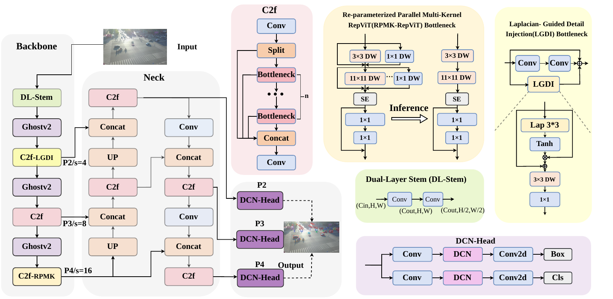
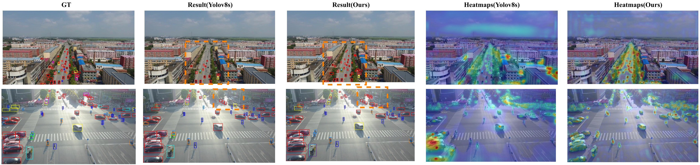

<div align="center">

# LDC-YOLO
### A Compact Detector for Small Objects in UAV Imagery

[](https://pytorch.org/)
[](https://docs.ultralytics.com/)
[](LICENSE)

**Laplacian-guided Detail and Context enhancement for UAV object detection**

</div>

LDC-YOLO combines shallow detail modulation and deep context aggregation in a compact **P2–P4** detector. This first release aligns the previous MKL-YOLO repository with the latest manuscript's terminology, module definitions, training protocol and reported results.

## Architecture



- **DL-Stem** projects features with a stride-1 3×3 convolution before stride-2 downsampling.
- **LGDI at P2** uses a fixed eight-neighbour Laplacian (centre 8, neighbours −1), BN and `tanh(abs(G))` to modulate features as `X * (1 + M)` before depthwise/pointwise refinement.
- **RPMK-RepViT at P4** uses successive `{1, 3}` and `{1, 3, 5, 7, 9, 11}` depthwise stages. Each stage fuses separately to a 3×3 or 11×11 convolution; SE and residual feed-forward refinement remain.
- **P2/P3/P4 heads** predict at strides 4/8/16, supported by GhostNetV2 downsampling, DCNv2 heads and WIoU regression.

## Paper results

Values below are **reported in the manuscript**, not measurements from a new training run in this release. AP values are percentages; complexity is reported at 640×640.

| Dataset | Model | AP50 | AP50:95 | Parameters (M) | FLOPs (G) |
|---|---|---:|---:|---:|---:|
| VisDrone2019-DET | LDC-YOLO-N | 41.00 | 25.00 | 1.15 | 8.214 |
| VisDrone2019-DET | **LDC-YOLO-S** | **49.30** | **30.83** | **3.56** | **26.634** |
| UAVDT | LDC-YOLO-S | 55.40 | 34.90 | 3.56 | 26.634 |

Full main-comparison and cumulative-ablation tables: [`results/`](results/).

## Installation

Use Python 3.10 or newer with a compatible PyTorch/torchvision pair.

```bash
git clone https://github.com/BatianZhu25/LDC-yolo.git
cd LDC-yolo
pip install -r requirements.txt
pip install -e .
```

Alternatively, `conda env create -f environment.yaml && conda activate ldc-yolo`, then `pip install -e .`. Ultralytics is pinned to **8.3.0** for custom model parsing. DCNv2 requires working torchvision deformable-convolution operators.

## Data preparation

See [`data/README.md`](data/README.md) for sources, class mappings and directory layout. Set the local dataset root in `configs/data/visdrone.yaml` or `configs/data/uavdt.yaml`. Images and labels are downloaded from the original dataset providers.

VisDrone annotation conversion:

```bash
python scripts/prepare_visdrone.py --source /path/to/VisDrone2019-DET-train --output /path/to/VisDrone --split train
python scripts/prepare_visdrone.py --source /path/to/VisDrone2019-DET-val --output /path/to/VisDrone --split val
```

## Training

The manuscript uses separate training on VisDrone and UAVDT: **640×640**, **300 epochs**, **SGD**, initial learning rate **0.01**, cosine decay, momentum **0.937**, weight decay **0.0005**, batch size **32**, and eight RTX 2080 Ti GPUs. The launch configuration defaults to one GPU; select devices to suit your machine.

```bash
# LDC-YOLO-S on VisDrone
python src/train.py --data configs/data/visdrone.yaml --name ldc_yolo_s_visdrone

# LDC-YOLO-N on VisDrone
python src/train.py --model configs/model/ldc_yolov8n.yaml --data configs/data/visdrone.yaml --name ldc_yolo_n_visdrone

# LDC-YOLO-S on UAVDT
python src/train.py --data configs/data/uavdt.yaml --name ldc_yolo_s_uavdt

# Multiple GPUs (batch is the total batch size in this implementation)
python src/train.py --device 0,1,2,3,4,5,6,7 --name ldc_yolo_s_visdrone
```

The first-release loss uses **WIoU-v1** with the upstream DFL term. Augmentation strengths and initialization defaults are editable in `configs/train.yaml`.

## Evaluation and export

```bash
python src/eval.py --model runs/train/ldc_yolo_s_visdrone/weights/best.pt --data configs/data/visdrone.yaml
python src/export.py --weights runs/train/ldc_yolo_s_visdrone/weights/best.pt --format onnx --fuse-reparam
```

Evaluation defaults to the validation split. Re-parameterization requires evaluation mode and frozen BN statistics. Export with DCNv2 depends on the selected backend's operator support.

## Qualitative examples



## Repository

```text
configs/             Model, dataset and training settings
src/ldc_yolo/        DL-Stem, LGDI, RPMK-RepViT, DCNv2 and WIoU trainer
src/{train,eval,export}.py
scripts/             Training launchers and VisDrone conversion
results/             Manuscript comparison and ablation tables
assets/              Manuscript architecture and qualitative examples
```

**First-release status.** This repository includes paper-aligned modules and runnable model configurations. The original training checkpoints, exact UAVDT sequence split and complete training records will be added later. Configuration widths/depths are inherited from the earlier code and still require confirmation against the final experimental checkpoints; the reported parameter/FLOP values above are not asserted as verified profiles of these configurations. The manuscript does not identify the WIoU variant, so this release explicitly uses v1. Previous `mkl_yolo` import paths are retained for compatibility.

## Citation

Manuscript: **LDC-YOLO: A Compact Detector for Small Objects in UAV Imagery**, Qiuming Luo, Tingfeng Luo, Haigang Zhang and Chang Kong. Publication metadata will be added when available.

## License

The repository retains its existing [MIT license](LICENSE). Ultralytics and the datasets have their own licenses and terms.
